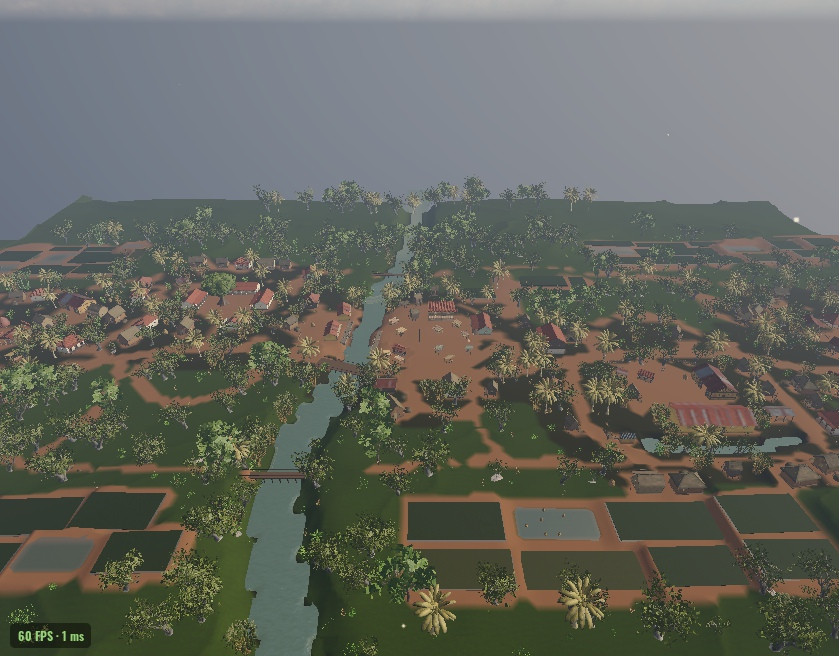

# D-243: fichas dos cinco lugares do Vale (2026-11-22)

Primeira versão, sem publicar. Capturas feitas no Studio em qualidade média, com o jogo do dono aberto.

## A. Olaria do Barranco

| Item | Descrição |
|---|---|
| Identidade | Dois fornos de tijolo em cúpula sobre terra vermelha |
| Silhueta | As cúpulas ao norte do pátio, com o galpão de chapa a leste |
| Paleta | Tijolo, barro vermelho, madeira escura e palha |
| Materiais | Tijolo à vista, tijolo cru, chapa enferrujada, tábua e esteira |
| Árvore | Figueira e coqueiro nos quintais |
| Chegada | Pela estrada do sul, com os fornos ao fundo (`d243/olaria_chegada.jpg`) |
| Melhor interior | Galpão de moldagem, com bancadas e estantes de potes (`d243/olaria_interior.jpg`) |
| Detalhe exclusivo | Fileiras de tijolo secando, tanque de barro e carroça |
| Função nas rotas | Galpão liga o pátio aos fundos; pilhas dão proteção baixa; fornos cortam a visada norte |
| Percurso lateral | Pela secagem, sob a cobertura (`d243/olaria_lateral.jpg`) |

## B. Escola do Pomar

| Item | Descrição |
|---|---|
| Identidade | Escola caiada em U em volta de uma figueira |
| Silhueta | Três alas baixas de telha, com a copa no meio |
| Paleta | Cal, telha vermelha, terra e verde do pomar |
| Materiais | Reboco caiado, telha, pilares de cal, tábua |
| Árvore | Figueira no pátio, bananeiras e coqueiro no pomar |
| Chegada | Pela rua do sul, com o U aberto (`d243/escola_chegada.jpg`) |
| Melhor interior | Salas ligadas por dentro, com lousas e carteiras (`d243/escola_interior.jpg`) |
| Detalhe exclusivo | Cisterna baixa e lousas em cada sala |
| Função nas rotas | As salas atravessam a ala; a varanda entra na captura |
| Percurso lateral | Varanda da ala oeste (`d243/escola_lateral.jpg`) |

## C. Mercado das Duas Margens (frente do canal)

| Item | Descrição |
|---|---|
| Identidade | Praça de toldos a leste, lojas estreitas a oeste e cais de pedra nas duas margens |
| Chegada | Pelo rio, entre os dois cais (`d243/mercado_canal.jpg`) |
| Detalhe exclusivo | Escadas para a água e barcos amarrados |
| Função nas rotas | As lojas se atravessam da frente aos fundos; o deck é um caminho junto da água |

O restante da ficha do Mercado está em `D-243_mercado_2026-11-22.md`.

## D. Engenho do Canal

| Item | Descrição |
|---|---|
| Identidade | Galpão comprido de chapa, com plataforma de carga coberta |
| Silhueta | Telhado longo e enferrujado fechando o sul do pátio |
| Paleta | Ocre, ferrugem, madeira e sacaria |
| Materiais | Reboco, chapa, treliça de madeira, tábua e saco |
| Árvore | Melaleucas junto do canal |
| Chegada | Pela rua do norte, de frente para a plataforma (`d243/engenho_chegada.jpg`) |
| Melhor interior | Salão com treliças, tremonhas e divisórias (`d243/engenho_interior.jpg`) |
| Detalhe exclusivo | Passarela de manutenção sobre as tremonhas |
| Função nas rotas | Plataforma na captura; salão e depósito como acessos; passarela dá altura moderada |
| Percurso lateral | Do alto da passarela (`d243/engenho_passarela.jpg`) |

## E. Vila dos Esteios

| Item | Descrição |
|---|---|
| Identidade | Casas sobre esteios em volta de um terreiro |
| Silhueta | Telhado de quatro águas da casa comunal, com a figueira ao lado |
| Paleta | Madeira escura, telha, terra e verde |
| Materiais | Tábua, telha, bambu e chapa |
| Árvore | Figueira no terreiro |
| Chegada | Pela rua do sul, com a casa comunal ao fundo (`d243/esteios_chegada.jpg`) |
| Melhor interior | Casa comunal aberta, com mesas compridas (`d243/esteios_interior.jpg`) |
| Detalhe exclusivo | Piso elevado com três escadas |
| Função nas rotas | Três entradas no terreiro; varandas dão altura local |
| Percurso lateral | Entre as palafitas do oeste (`d243/esteios_lateral.jpg`) |

## Aprovação visual

| Critério | A | B | C | D | E |
|---|---|---|---|---|---|
| 1. Identidade | aprovado | aprovado | aprovado | aprovado | aprovado |
| 2. Chegada | corrigir | aprovado | aprovado | aprovado | aprovado |
| 3. Interior | aprovado | aprovado | aprovado | corrigir | aprovado |
| 4. Corpo de 2,00 m | corrigir | corrigir | corrigir | corrigir | corrigir |
| 5. Luz e vegetação | não verificado | não verificado | não verificado | não verificado | não verificado |
| 6. Materiais e encontros | corrigir | corrigir | corrigir | corrigir | corrigir |
| 7. Rotas e visadas | não verificado | não verificado | não verificado | não verificado | não verificado |
| 8. Desempenho | não verificado | não verificado | não verificado | não verificado | não verificado |

- **Chegada da Olaria:** o primeiro plano do pátio ainda está vazio.
- **Interior do Engenho:** o fundo do salão fica escuro e as tremonhas estão vazias por dentro.
- **Corpo:** portas e escadas passam, mas o soldado mede 2,07 m, não 2,00 m.
- **Materiais:** o chão ainda é a textura geral do terreno, sem identidade por lugar.
- **Luz e vegetação:** só vistas em qualidade média, onde as copas grandes aparecem em cartões.
- **Rotas:** os percursos foram andados, mas as linhas de tiro não foram medidas.

## Medições

| Verificação | Resultado |
|---|---|
| Testes Lune | 986 ok em 73 arquivos |
| Modelos novos | 11, de 2.112 a 12.482 triângulos |
| Escola, pátio e três salas | 39 de 39 pontos a pé |
| Lojas estreitas | 3 de 3 atravessadas da frente aos fundos |
| Galpão da Olaria | 20 de 22 pontos, chegada a 0,4 m do alvo |
| Plataforma do Engenho | sobe 0,70 m |
| Passarela do Engenho | sobe 2,10 m, anda e desce |
| Casa comunal | sobe 0,70 m |
| Deck do cais | 13 de 13 pontos; chão atrás dele a no máximo 0,19 m |
| Bots | 30 vivos, nenhum parado em duas janelas de mais de 80 s |
| Mapa de sempre (autoteste) | 18 ok, 0 falhas, 0 pulados |
